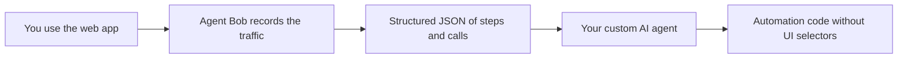
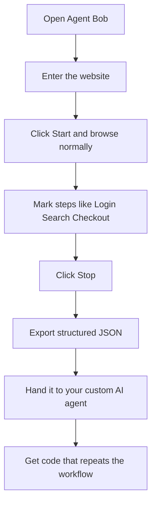
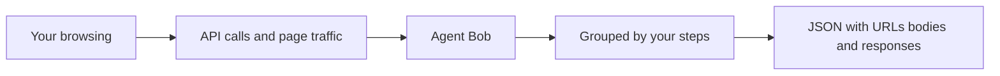

# Agent Bob

**Automate the web without selectors. Capture the APIs. Hand the result to AI.**

Agent Bob is a desktop app for **RPA developers** who are tired of brittle UI selectors and Selenium-style browser clicking. Instead of hunting for buttons on a page, you use the website yourself — and Bob quietly records the traffic and API calls happening behind the scenes.

Logins. Searches. Form saves. Popups. The lot.

Then Bob groups everything into a **structured JSON** of URLs, request bodies, and responses. That file is ready to hand to a **custom AI agent** that turns the recorded steps into real automation code.

---

## The idea

Classic RPA watches the screen. Agent Bob watches the **network**.

If a website already talks to APIs when you click around, those calls are often a cleaner, more stable path to automation than clicking pixels.



---

## Who it’s for

Built for robotics / RPA developers who want to automate websites and web apps when:

- Selectors keep breaking after every UI tweak  
- Selenium-style flows feel too fragile  
- The real work is already happening through APIs  
- You want a clean recording you can feed into an AI coding agent  

---

## How a session works



1. **Launch** Agent Bob  
2. **Open** the site or web app  
3. **Start recording** — a real Chrome window appears  
4. **Do the workflow** exactly as a user would  
5. **Name your steps** as important moments happen  
6. **Stop** and export the structured JSON  
7. **Pass that JSON** to your custom AI agent to generate the automation

---

## What gets captured

While you browse, Bob listens across pages, tabs, and popups in the session.



Each useful call can include:

- The **URL**  
- The **request body**  
- The **response**  
- The **step** it belongs to  

So your AI agent doesn’t just see “someone clicked around” — it sees the actual conversation the website had with its backend.

---

## Why this beats selector hunting

| Old way | Agent Bob way |
|--------|----------------|
| Find fragile UI selectors | Capture the real API traffic |
| Rebuild flows in Selenium | Record once by using the site |
| Break when the UI moves | Lean on the calls the app already makes |
| Hand vague notes to AI | Hand structured JSON of URLs, bodies, and responses |

---

## Quick start

### Run the app

Open the portable build:

`dist/AgentBob-1.0.0-portable.exe`

No Node.js needed just to run it.

### Build it yourself

```bash
npm install
npm run build:portable
```

Installer + portable:

```bash
npm run build:win
```

### Develop locally

```bash
npm start
```

---

## A note on the browser

Bob prefers **real Google Chrome** with a saved profile, so logins can stick between sessions and the browser feels less like a bot. If Chrome isn’t available, it can fall back to a bundled browser.

---

## Bottom line

**Show the workflow once. Capture the APIs. Let AI write the automation.**

Agent Bob helps RPA developers skip UI selectors and Selenium gymnastics — and start from the traffic that already makes the web app work.
