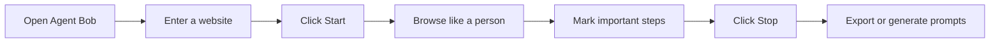
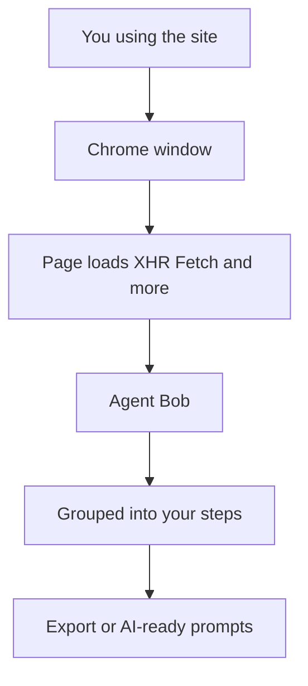
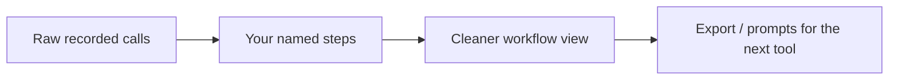

# Agent Bob

**Watch someone use a website. Turn that journey into a clear map of every call the site makes.**

Agent Bob is a desktop recorder for real browser work. You open a site, click around like a normal user, and Bob quietly captures the traffic behind the scenes — logins, searches, form saves, popups, the lot. Then you group what happened into steps and walk away with something you can actually reuse.

No extension fights. No “install this in Chrome first.” Just start, browse, stop.

---

## Why it exists

Modern websites hide a storm of requests behind every button. Rebuilding that by hand is slow and easy to get wrong. Agent Bob lets you **do the work once in a real browser** and keep a faithful record of what the site did.

Great when you need to:

- Understand how a workflow really talks to its APIs
- Hand a clean sequence to automation or an AI coding agent
- Capture traffic even when company browsers block extensions
- Keep cookies and logins so the next session feels like *your* browser, not a fresh bot

---

## How a session feels



1. **Launch** Agent Bob  
2. **Enter** the site you care about  
3. **Start** — a real Chrome window opens  
4. **Use the site** — clicks, forms, new windows, all fair game  
5. **Name your steps** as you go (“Login”, “Search”, “Checkout”)  
6. **Stop** when you’re done and export what you need

---

## What Bob watches

While you browse, Bob listens to the network across every tab and popup in that session.



- Records **as it happened** — including sensitive values when they appear  
- Follows **new windows and tabs** opened from the same session  
- Uses your **installed Chrome** with a saved profile when possible, so logins stick around  
- Still works with a bundled browser fallback if Chrome isn’t available

---

## From clicks to clarity

Raw traffic alone is noisy. Bob helps you turn it into a story:



Mark a step when something meaningful happens. Later calls line up under that step, so “what did login do?” has a simple answer.

---

## Quick start

### Run the app

If you already have the portable build, just open:

`dist/AgentBob-1.0.0-portable.exe`

No Node.js needed on the machine that only runs the app.

### Build it yourself

```bash
npm install
npm run build:portable
```

Want an installer too?

```bash
npm run build:win
```

### Develop locally

```bash
npm start
```

---

## A note on the Chrome window

Bob prefers **real Google Chrome** and keeps a profile under your app data folder. That means fewer “are you a robot?” surprises, and your cookies can survive between recordings. Strong anti-bot sites can still be picky — but this is much closer to everyday browsing than a blank automation browser.

---

## Repo

Private project for Agent Bob desktop recording.

Built for people who would rather **show** a workflow than reverse-engineer it.
